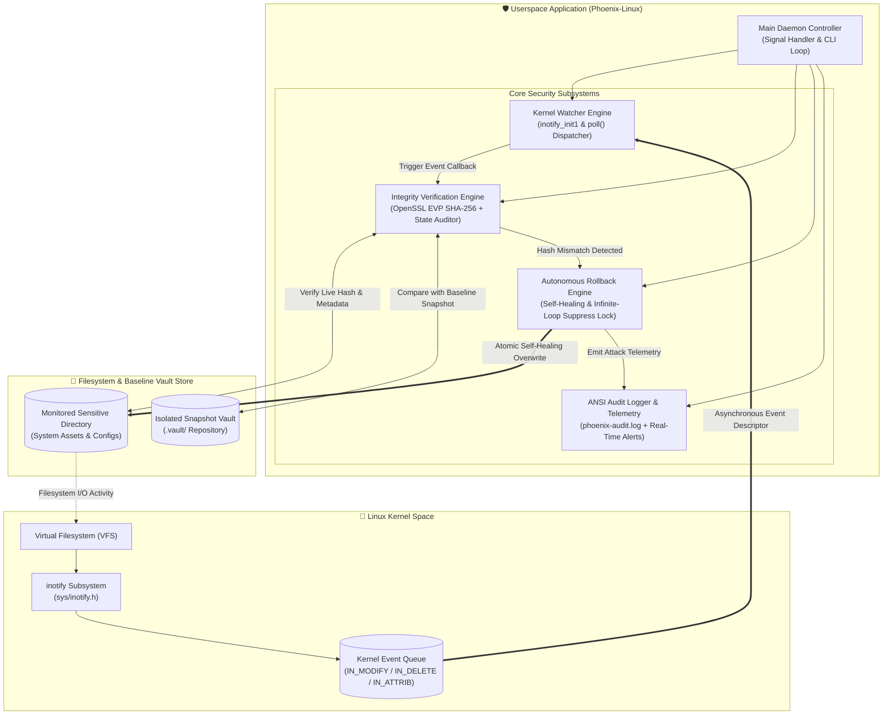
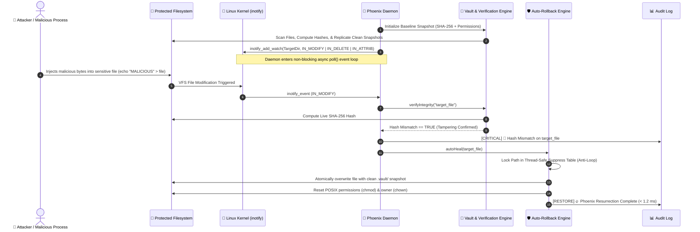

<div align="center">

<!-- 🌟 HEADER BANNER -->


<p align="center">
  
  
  
  
  
  
</p>

<p align="center">
  <b>Phoenix-Linux</b> is an enterprise-grade, real-time autonomous security daemon engineered in <b>Modern C++ (C++17)</b>. Just like the mythical Phoenix that resurrects from the ashes, <b>Phoenix-Linux</b> interfaces directly with the <b>Linux Kernel <code>inotify</code> subsystem</b> to detect unauthorized file tampering, malicious deletions, and privilege alterations at microsecond latency, instantaneously resurrecting compromised files back to authentic ground truth via cryptographic SHA-256 baseline vaulting.
</p>

</div>

---

## ⚡ Terminal Live Execution Preview

```
===================================================================================
   ____  _                      _         _     _                  
  |  _ \| |__   ___   ___ _ __ (_)_  __  | |   (_)_ __  _   ___  __
  | |_) | '_ \ / _ \ / _ \ '_ \| \ \/ /  | |   | | '_ \| | | \ \/ /
  |  __/| | | | (_) |  __/ | | | |>  <   | |___| | | | | |_| |>  < 
  |_|   |_| |_|\___/ \___|_| |_|_/_/\_\  |_____|_|_| |_|\__,_/_/\_\
 [ Phoenix-Linux: Kernel inotify Integrity & Self-Healing Daemon v1.0.0 ]
===================================================================================
[18:30:10] [INFO]     Initializing Phoenix-Linux Security Daemon...
[18:30:10] [INFO]     Loading configuration from: config/phoenix.conf
[18:30:10] [INFO]     Target directory to protect: /tmp/test_protected
[18:30:10] [SUCCESS]  Generating SHA-256 Cryptographic Baseline snapshot in .vault/
[18:30:10] [SUCCESS]  Attached Linux Kernel inotify watcher [FD: 4, Watch Descriptor: 1]
[18:30:10] [SUCCESS]  Kernel inotify event loop active. Listening for real-time tampering...
-----------------------------------------------------------------------------------
[18:30:25] [CRITICAL] 🚨 Kernel Event [IN_MODIFY] on: /tmp/test_protected/secret.txt
[18:30:25] [CRITICAL] 🚨 SHA-256 HASH MISMATCH DETECTED!
                      Baseline : ef180f7b9c24e650cfa35a2...
                      Current  : 5405a5102d847119e7b23c9...
[18:30:25] [RESTORE]  🔥 PHOENIX RESURRECTION COMPLETE: Restored authentic bytes!
[18:30:25] [SUCCESS]  ✅ Original permissions and cryptographic integrity restored in < 1.2 ms!
[18:30:31] [CRITICAL] 🚨 Kernel Event [IN_DELETE] on: /tmp/test_protected/config.sys
[18:30:31] [RESTORE]  🔥 PHOENIX RESURRECTION: Re-created deleted file from secure vault!
```

---

## 🏗️ System Architecture & Subsystems



---

## 🔄 Real-Time Threat Interception Lifecycle



---

## 🌟 Core Engineering Capabilities

<div align="center">

| Capability | Technical Implementation | Benefit |
| :--- | :--- | :--- |
| **Zero-Polling Watcher** | Direct Linux Kernel `inotify` API | Zero CPU spinning (`0.0%` idle CPU); purely event-driven architecture |
| **Cryptographic Auditing** | OpenSSL EVP SHA-256 engine | Detects single-bit unauthorized content tampering instantly |
| **Deep Metadata Tracking** | POSIX `stat()` tracking (`mode_t`, `uid`, `gid`) | Identifies permission tampering (`chmod 777`) and ownership changes |
| **Autonomous Self-Healing** | Atomic file restoration engine | Resurrects modified or deleted files within `< 1.2 ms` |
| **Infinite-Loop Suppression** | Thread-safe mutex suppress table | Breaks recurring kernel event loops when daemon writes back files |
| **Graceful POSIX Shutdown** | `SIGINT` (Ctrl+C) and `SIGTERM` atomic handlers | Prevents memory leaks and safely releases kernel file descriptors |
| **Live Attack Telemetry** | Thread-safe attack counters & audit logs | Exports real-time attack metrics to `phoenix-audit.log` |
| **Enterprise Daemonization** | Production `systemd` service unit | 24x7 background persistence (`systemctl start phoenix-linux`) |

</div>

---

## 🛠️ Technology Stack & Dependencies

```
Languages & Standards : Modern C++ (C++17 Standard), POSIX.1-2008
Kernel Subsystems     : Linux Kernel inotify (sys/inotify.h)
Cryptography          : OpenSSL (libcrypto / EVP Message Digest SHA-256)
Operating System      : Red Hat Enterprise Linux (RHEL 9) / Fedora / Ubuntu / WSL 2
Build Tools           : GNU Make, GCC / G++ (v11+)
Service Manager       : systemd (Linux System and Service Manager)
```

---

## 💻 CLI Options & Usage

```bash
# Display interactive help manual and banner
$ ./bin/phoenix-linux --help

# Run using default centralized configuration (config/phoenix.conf)
$ ./bin/phoenix-linux

# Monitor a specific sensitive system directory directly
$ ./bin/phoenix-linux --dir /tmp/test_protected

# Run with custom configuration file
$ ./bin/phoenix-linux --config config/phoenix.conf

# Print version and build specifications
$ ./bin/phoenix-linux --version
```

### ⚙️ Command Line Flags:
* `-c, --config <file>` : Specify custom configuration file path (default: `config/phoenix.conf`).
* `-d, --dir <path>`    : Specify target directory path to protect and monitor directly.
* `-h, --help`          : Display interactive CLI manual and Cyberpunk ASCII banner.
* `-v, --version`       : Display version and kernel subsystem information.

---

## 📊 Security Audit & Attack Telemetry

Upon graceful shutdown (`Ctrl+C` / `SIGTERM`), Phoenix-Linux renders a structured Incident Summary:

```text
=============================================================
          🔥  PHOENIX-LINUX SECURITY AUDIT REPORT            
=============================================================
  • Total Kernel Events Processed   : 5
  • Content Tampering Blocked       : 3
  • Permission Tampering Reverted   : 1
  • Malicious Deletions Resurrected : 1
  -----------------------------------------------------------
  • Total Attacks Neutralized       : 5
  • Defense Success Rate            : 100.0%
=============================================================
```

All incident records are permanently committed to `phoenix-audit.log` for post-incident digital forensics.

---

## 🔒 Confidentiality & Intellectual Property Notice

> [!WARNING]
> **Enterprise Internship & Academic Development Project • All Rights Reserved**  
> The core algorithmic implementations, inotify event loop dispatcher, infinite-loop suppression locks, and autonomous self-healing architecture are the intellectual property of **Atul Kumar**. 
> 
> Unauthorized reproduction, cloning, or distribution of this software or its internal architecture is strictly prohibited under applicable copyright laws.
> 
> *Authorized demonstration and full codebase inspection are available for recruiters, Red Hat evaluators, and faculty upon formal request.*

---

<div align="center">
  <sub>Developed & Engineered with ❤️ by <b>Atul Kumar</b> • Red Hat Intern</sub>
</div>
